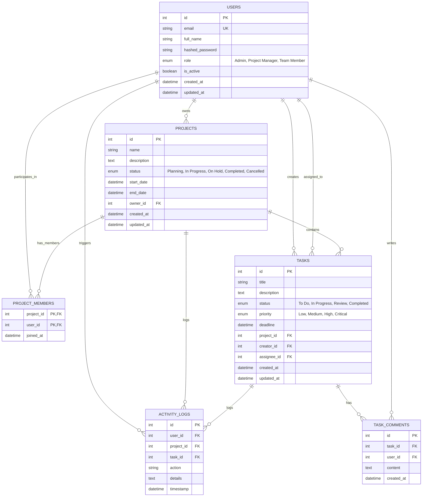

# Entity Relationship (ER) Diagram

The following diagram illustrates the relational database model of the **Advanced Project & Team Management System** built with SQLAlchemy ORM and SQLite/PostgreSQL.

